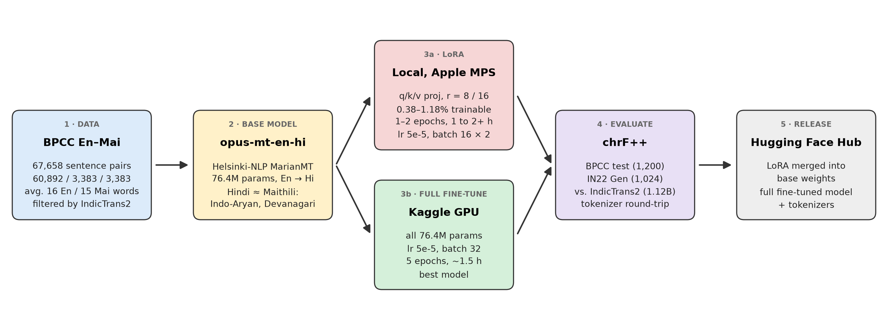
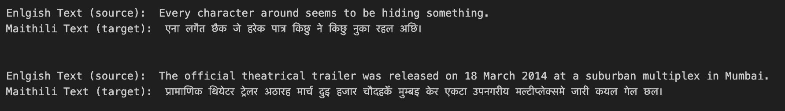
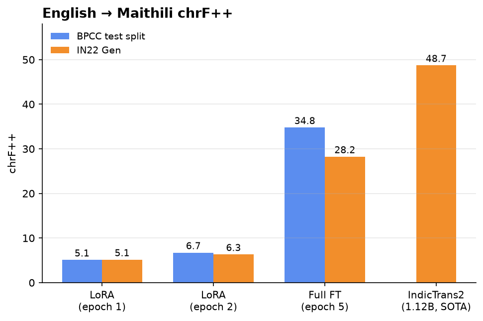
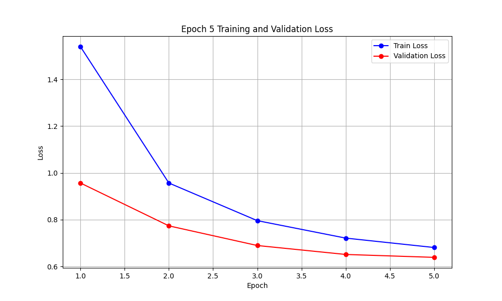
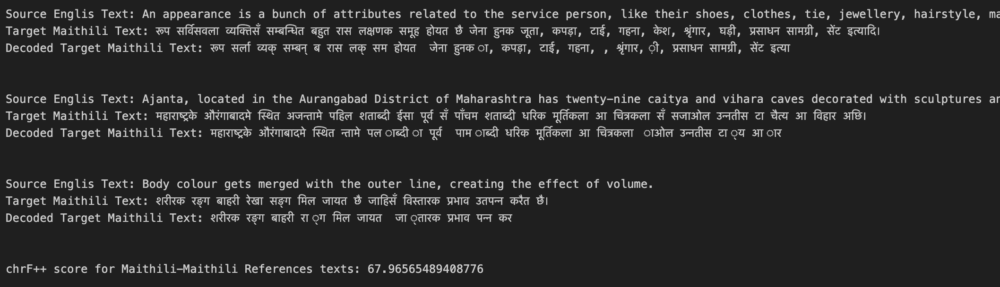

# Efficient Low-Resource Machine Translation: English to Maithili


Maithili is spoken by over 34 million people, yet it has very little digital infrastructure and almost no dedicated machine translation research. This repository builds a **lightweight English → Maithili translation model** by transferring from a related language: we fine-tune the 76M-parameter Helsinki-NLP English → Hindi MarianMT model on the BPCC English–Maithili corpus and compare parameter-efficient (LoRA) and full fine-tuning against the 1.12B-parameter IndicTrans2 state of the art, using chrF++ on the IN22 Gen benchmark.

## Deliverables

| Artifact | Description |
|----------|-------------|
| [Project Report (PDF)](report.pdf) | Full write-up covering related work, datasets, approaches considered, LoRA and full fine-tuning results, tokenizer error analysis, and future directions. |
| [Fine-tuned Model (Hugging Face)](https://huggingface.co/kubershahi/Helsinki-NLP-opus-mt-eng-mai-epoch5) | Full fine-tune of `opus-mt-en-hi` for 5 epochs. Best model (28.22 chrF++ on IN22 Gen). |
| [LoRA Fine-tuned Model (Hugging Face)](https://huggingface.co/kubershahi/Helsinki-NLP-opus-mt-eng-mai-lora-epoch2) | LoRA adapters (rank 16 on q/k/v projections) merged into the base model after 2 epochs. |

## Overview

The goal is not to beat large multilingual models, but to get **comparable quality from a model ~15× smaller** that can be fine-tuned on commodity hardware and integrated easily into web applications. Maithili, Hindi, and Nepali are all Indo-Aryan languages written in Devanagari, so an English → Hindi model is a natural starting point for transfer learning.



## Project Structure

```text
.
├── dataset/
│   ├── train/bpcc/                 # BPCC English–Maithili parallel corpus (67,658 pairs)
│   ├── training_split/bpcc/        # train / val / test splits (60,892 / 3,383 / 3,383)
│   └── test/
│       ├── IN22_test/gen/          # IN22 Gen benchmark (1,024 pairs) — primary evaluation
│       ├── IN22_test/conv/         # IN22 Conv benchmark (conversational)
│       └── flores_200_dev/         # FLORES-200 dev set (eng / hin / mai)
├── notebooks/
│   ├── local_lora_finetuning.ipynb # LoRA fine-tuning on a local machine (Apple MPS)
│   ├── local_lora_testing.ipynb    # chrF++ evaluation of LoRA checkpoints
│   ├── kaggle_finetuning.ipynb     # Full-model fine-tuning on Kaggle free-tier GPUs
│   ├── push_models.ipynb           # Merge LoRA weights and push models to Hugging Face
│   ├── tokenizer_analysis.ipynb    # Encode/decode round-trip check of the En–Hi tokenizer
│   └── report_details.ipynb        # Dataset statistics and report figures
├── img/
│   ├── overview/                   # project-overview.png (pipeline)
│   ├── evaluation/                 # chrf-comparison.png
│   ├── bpcc/                       # Dataset samples
│   ├── epoch1/, epoch2/            # LoRA training curves and test outputs
│   ├── epoch5/                     # Full fine-tuning curves and test outputs
│   └── tokenizer/                  # Tokenizer round-trip check
├── report.pdf                      # Project report
├── requirements.txt                # Python dependencies
└── README.md
```

Local checkpoints (`finetuned/`) and trainer outputs (`results/`) are git-ignored; the trained models are available on Hugging Face (see [Deliverables](#deliverables)).

## Datasets

| Dataset | Role | Size | Notes |
|---------|------|------|-------|
| **BPCC** (IndicTrans2) | Training | 67,658 pairs | Filtered NLLB data plus Wikipedia and conversational text; avg. 16 English / 15 Maithili words per sentence |
| **IN22 Gen** (IndicTrans2) | Benchmark | 1,024 pairs | General-domain benchmark; avg. 24 words per sentence |
| BPCC test split | Held-out test | 1,200 sampled | Random sample (seed 42) of the 3,383-pair test split |

The BPCC corpus was already de-duplicated, aligned, and toxicity-filtered by the IndicTrans2 team, so no further preprocessing was required. The raw NLLB English–Maithili data (~4.4M pairs) was not used because of misalignments, untranslated segments, and low-quality entries.



## Approaches Considered

| Approach | Idea | Outcome |
|----------|------|---------|
| Train from scratch | Dedicated English–Maithili encoder–decoder | Rejected: no suitable 4–5M-parameter seq2seq model; tiny-mBART (500k) too small for translation |
| Pivot through Hindi | English → Hindi model chained with a new Hindi → Maithili model | Rejected: same lack of a compact model for the second hop |
| **Fine-tune En → Hi model** | Transfer from a related Devanagari-script language | **Selected**: Helsinki-NLP `opus-mt-en-hi` (76M parameters) |

## Fine-tuning Variants

All variants start from [`Helsinki-NLP/opus-mt-en-hi`](https://huggingface.co/Helsinki-NLP/opus-mt-en-hi) and use a learning rate of 5e-5.

| Variant | Hardware | Configuration | Trainable params | Training time |
|---------|----------|---------------|------------------|---------------|
| **LoRA, epoch 1** | Local (Apple MPS) | r=8, α=16, dropout 0.01, targets `q_proj`, `v_proj`; batch 16, grad. accum. 2 | 294,912 (0.38%) | ~1 h |
| **LoRA, epoch 2** | Local (Apple MPS) | r=16, α=32, dropout 0.1, bias `lora_only`, targets `q_proj`, `k_proj`, `v_proj`; batch 16, grad. accum. 2 | 912,384 (1.18%) | >2 h |
| **Full fine-tune, epoch 5** | Kaggle free-tier GPU | All weights; batch 32, 5 epochs | 76.4M (100%) | ~1.5 h |

## Quick Start

### Install dependencies

```bash
python -m venv .venv
source .venv/bin/activate
pip install -r requirements.txt
```

Transformers is pinned below 5.0 because the notebooks pass `tokenizer=` to `Seq2SeqTrainer`, which Transformers 5 removed.

### Translate with the fine-tuned model

```python
from transformers import AutoModelForSeq2SeqLM, AutoTokenizer

model_id = "kubershahi/Helsinki-NLP-opus-mt-eng-mai-epoch5"
tokenizer = AutoTokenizer.from_pretrained(model_id)
model = AutoModelForSeq2SeqLM.from_pretrained(model_id)

inputs = tokenizer(["Every character around seems to be hiding something."], return_tensors="pt", padding=True)
outputs = model.generate(**inputs, max_length=128)
print(tokenizer.batch_decode(outputs, skip_special_tokens=True))
```

### Reproduce the experiments

| Step | Notebook |
|------|----------|
| LoRA fine-tuning (local) | [`notebooks/local_lora_finetuning.ipynb`](notebooks/local_lora_finetuning.ipynb) |
| LoRA evaluation | [`notebooks/local_lora_testing.ipynb`](notebooks/local_lora_testing.ipynb) |
| Full fine-tuning (Kaggle) | [`notebooks/kaggle_finetuning.ipynb`](notebooks/kaggle_finetuning.ipynb) |
| Push models to Hugging Face | [`notebooks/push_models.ipynb`](notebooks/push_models.ipynb) |
| Tokenizer analysis | [`notebooks/tokenizer_analysis.ipynb`](notebooks/tokenizer_analysis.ipynb) |
| Report statistics and figures | [`notebooks/report_details.ipynb`](notebooks/report_details.ipynb) |

The local notebooks use Apple's `mps` device; change `torch.device("mps")` to `"cuda"` or `"cpu"` for other hardware.

## Evaluation

Following IndicTrans2, we report **chrF++**, a character n-gram F-score augmented with word n-grams. It is better suited than BLEU to morphologically rich Indic languages, where inflection makes exact word matches sparse. Models are evaluated on 1,200 random examples from the BPCC test split and on all 1,024 examples of the IN22 Gen benchmark.



| Model | Params | BPCC Test Split | IN22 Gen |
|-------|--------|-----------------|----------|
| IndicTrans2 (SOTA baseline) | 1.12B | — | **48.7** |
| LoRA, epoch 1 | 76M | 5.07 | 5.13 |
| LoRA, epoch 2 | 76M | 6.71 | 6.30 |
| **Full fine-tune, epoch 5** | 76M | **34.76** | **28.22** |

Evaluating the full fine-tuned model on Kaggle took about 5 minutes on the test split and 3 minutes on IN22 Gen; the LoRA checkpoints took over an hour each on the local machine.



## Key Findings

1. **Full fine-tuning far outperforms LoRA**: 28.22 vs 6.30 chrF++ on IN22 Gen. Translation requires learning the syntax and semantics of a new target language, and low-rank adapters on the attention projections alone were not enough in our setup.
2. **The borrowed tokenizer is a bottleneck**: Encoding and decoding IN22 Gen Maithili references with the English–Hindi tokenizer drops characters, and the round trip scores only **68 chrF++** against the original text (ideal: 100). This caps achievable quality regardless of training.
3. **The base model limits the ceiling**: `opus-mt-en-hi` scores 27.32 chrF++ on English → Hindi IN22 Gen, compared with 56.7 for IndicTrans2, so a stronger English → Hindi starting point should transfer better to Maithili.
4. **A 15× smaller model reaches ~58% of SOTA quality** on IN22 Gen after 1.5 hours of free-tier GPU training, showing that related-language transfer is a viable path for low-resource Indic languages.



## Future Work

- Train a Maithili-aware tokenizer on monolingual Maithili text, or extend the English–Hindi vocabulary.
- Start from a stronger English → Hindi (or English → Nepali) base model.
- Apply LoRA to more layers (output and feed-forward), not just the attention projections.
- Run longer full fine-tuning and hyperparameter sweeps with more compute.

## References

- Gala et al. (2023). [IndicTrans2: Towards High-Quality and Accessible Machine Translation Models for all 22 Scheduled Indian Languages](https://arxiv.org/abs/2305.16307). Source of BPCC and IN22.
- Costa-jussà et al. (2022). [No Language Left Behind: Scaling Human-Centered Machine Translation](https://arxiv.org/abs/2207.04672). Source of NLLB data and FLORES-200.
- Popović (2017). [chrF++: words helping character n-grams](https://aclanthology.org/W17-4770/).
- Helsinki-NLP. [opus-mt-en-hi](https://huggingface.co/Helsinki-NLP/opus-mt-en-hi).

## License

Released under the [MIT License](LICENSE).
